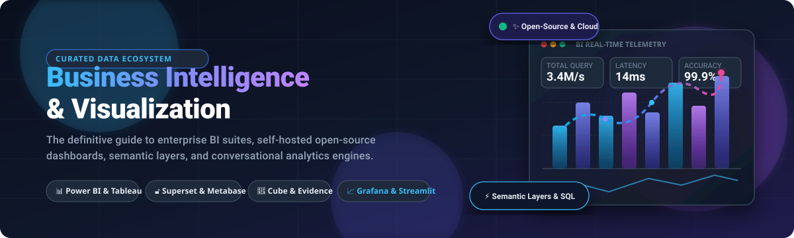

# Awesome-Business-Intelligence-Visualization

# Awesome-Business-Intelligence-Visualization 📊 📈

  

  
  
  
  
  
  

---

## 🌟 Top Business Intelligence & Visualization Ecosystem

**Curated List of Commercial BI Platforms, Cloud Analytics, & Open-Source Visualization Frameworks**  
*Focused on Interactive Dashboards, Semantic Layers, Self-Service Analytics, Embedded BI, Conversational AI Analytics, Data Storytelling, and Self-Hosted Business Intelligence.*

**Last updated: October 2026** 📅

---

### 📌 Overview & SEO Summary

Welcome to the definitive curated directory of **business intelligence and data visualization platforms**, **open-source BI frameworks**, **embedded analytics solutions**, and **interactive dashboarding tools**. Whether you are evaluating tier-1 enterprise SaaS suites (such as *Microsoft Power BI*, *Salesforce Tableau*, and *Google Looker*), spreadsheet-native interfaces (*Sigma Computing*), conversational AI copilots (*Zaturn*, *ThoughtSpot*), or self-hostable open-source powerhouses (*Grafana*, *Apache Superset*, *Metabase*, *Cube*, *Perspective*, and *Streamlit*), this comprehensive guide outlines real pricing tiers, free trial boundaries, market caps, GitHub popularity, and architectural trade-offs.

**Key Market Context & Insights:**
- **Market Sizing & Dynamics:** The global Business Intelligence and Visualization market is projected by MarketsandMarkets to expand from **$31.5 Billion in 2025 to $54.3 Billion by 2030 (11.5% CAGR)**.
- **Market Structure:** The sector remains **moderately fragmented**: mega-cap hyper-scalers (Microsoft, Salesforce, Google) capture massive enterprise share via bundle discounting, while high-velocity specialized platforms (Sigma Computing, ThoughtSpot, Sisense, GoodData) and headless semantic layers (Cube, Lightdash) win distinct segments in embedded analytics, cloud data warehouse computation, and code-first workflows.
- **Enterprise Benchmarks:** **Power BI leads G2's 2026 BI rankings with a score of 9.2/10** and holds a **4.5/5 rating across 2,750+ Gartner Peer Insights reviews**, backed by its disruptive **$14/user/month Pro plan** — the lowest entry tier among tier-1 enterprise platforms.
- **Open-Source Dominance:** **Grafana (>77,000 stars)** and **Apache Superset (>75,000 stars)** represent the dual pillars of modern self-hosted dashboarding and observability, while **Metabase (>49,000 stars)** offers rapid non-technical adoption with single-JAR deployment.

---

## 📑 Table of Contents

- [🏢 SaaS & Commercial Platforms](#-saas--commercial-platforms)
- [🔓 Open-Source GitHub Projects](#-open-source-github-projects)
- [🛠️ How to Contribute](#%EF%B8%8F-how-to-contribute)
- [📊 Star History](#-star-history)
- [🤝 Support & Sponsorship](#-support--sponsorship)
- [⚠️ Disclaimer](#%EF%B8%8F-disclaimer)

---

## 🏢 SaaS / Commercial Platforms

> **Market Analysis & Fragmentation:** The global Business Intelligence market is valued at **$31.5 Billion (growing to $54.3 Billion by 2030 at 11.5% CAGR)** and remains **moderately fragmented** — anchored by mega-cap titans (Microsoft Power BI, Salesforce Tableau, Google Looker) commanding broad enterprise dominance alongside agile, high-growth contenders (Sigma Computing, ThoughtSpot, Sisense, GoodData) competing aggressively in embedded BI, semantic layers, and warehouse-native analytics.

*Sorted by Valuation / Market Capitalization (Descending)* 💼

| SaaS / Commercial Platform | Company / Owner | Valuation / Market Cap | Pricing (Starting Tier) | Free Tier / Free Trial Limits | Description |
| :--- | :--- | :--- | :--- | :--- | :--- |
| **[Microsoft Power BI](https://powerbi.microsoft.com/)** 🔷 | Microsoft | **~$3.90 Trillion** | **$14/user/month** (Pro plan); Premium Per User: $24/user/month | **Free Desktop version** (local authoring free forever); **60-day free Pro trial** with full cloud sharing | **Most widely adopted enterprise BI platform** — **2026 G2 score: 9.2/10** . **Gartner Peer Insights: 4.5/5** . Native DAX modeling, Excel integration, Microsoft Fabric lakehouse foundation, and Copilot AI natural language insights . ~25% market share . |
| **[Looker](https://looker.com/)** 🔍 | Google (Alphabet) | **~$2.0 Trillion** | **$36,000/year** ($3,000/month platform fee) + $30/user/month standard viewer | **No free tier**; custom proof-of-concept evaluation instances provisioned via Google Cloud Sales only *(Note: Looker Studio standalone is free)* | **Centrally governed metrics platform** — Industry-standard **LookML semantic layer** defines dimensions, metrics, and joins once centrally . Seamlessly integrates with Google Cloud BigQuery and multi-cloud warehouses . |
| **[Salesforce Tableau](https://www.tableau.com/)** 📊 | Salesforce | **~$250 Billion** | **$15/user/month** (Tableau Viewer); Creator: $75/user/month; Explorer: $42/user/month | **14-day full-feature free trial** (Tableau Desktop/Cloud); **Tableau Public is 100% free forever** for public visualization publishing | **Visual analytics and exploration benchmark** — **2026 G2 score: 8.9/10** . Drag-and-drop visual interface with infinite calculation customization, Tableau Pulse for automated metric digests, and Tableau Agent for generative querying . |
| **[ThoughtSpot](https://www.thoughtspot.com/)** 🔍 | ThoughtSpot | **~$4.0 Billion** | **$95/user/month** (Essentials plan) | **14-day free trial** (no credit card required); **Embedded Developer tier is free for 1 year** (limited to 10 users and 25M data rows) | **Search- and AI-driven business intelligence** — Natural language search interface (ThoughtSpot Sage) powered by LLMs to query warehouse tables without writing SQL . Robust headless embedding SDK for software applications . |
| **[Sigma Computing](https://www.sigmacomputing.com/)** 📈 | Sigma Computing | **~$3.0 Billion** | **$25/user/month** (Essentials plan; billed annually) | **7-day free trial** (hands-on access with no credit card required; connects to Snowflake, Databricks, BigQuery, or Redshift) | **Cloud data warehouse-native spreadsheet BI** — Combines familiar spreadsheet formulas with limitless warehouse elasticity . Instant real-time calculation pushdown with zero extracts and zero data movement . |
| **[Qlik Sense](https://www.qlik.com/)** 🟢 | Qlik | **~$3.0 Billion** | **$20/user/month** (Standard plan; minimum 10 users = $200/mo); Premium: $2,700/mo | **30-day free trial** (Qlik Cloud Analytics, up to 5 users, full interactive dashboards without credit card) | **Associative analytics engine** — Unique in-memory associative calculation model that surfaces hidden data relationships without relational query limits . Automated machine learning (AutoML) built directly into analytical flows . |
| **[Sisense](https://www.sisense.com/)** 🟣 | Sisense | **~$1.1 Billion** | **$10,000/year** (~$833/month entry starting tier for self-hosted/small teams) | **7-day free test drive** (pre-loaded sample schemas or custom upload to test embedded dashboards and AI analytics) | **Purpose-built embedded analytics platform** — Designed specifically for OEM integration inside customer-facing web and mobile applications . Elasticube high-speed caching engine with Sisense Fusion AI copilots . |
| **[Domo](https://www.domo.com/)** 🎯 | Domo Inc. | **~$1.0 Billion** | **$25/user/month** (Standard plan; billed annually) | **30-day free trial** (fully-featured enterprise capabilities including Magic ETL pipelines and AI Chat; no credit card required) | **Full-stack business cloud platform** — **2026 G2 score: 8.5/10** . Combines drag-and-drop ETL data pipelining (Magic ETL), executive dashboard creation, and mobile application builder into a unified managed cloud service . |
| **[GoodData](https://www.gooddata.com/)** 🏗️ | GoodData | **~$300 Million** | **$1,500/month** (Professional tier platform fee with unlimited users and data) | **GoodData Free plan free for 6 months** (up to 5 workspaces, 100MB customer data per workspace, 4 uploads/day, 2 concurrent queries); **30-day trial** for Pro | **Composable, multi-tenant analytics platform** — Decoupled semantic engine built on Apache Arrow, DuckDB, and Iceberg . React and JavaScript SDKs for white-labeled multi-tenant SaaS application embedding . |
| **[Metabase Enterprise](https://www.metabase.com/)** 🎯 | Metabase | **~$200 Million** | **$500/month** (Cloud Pro plan, includes 5 users, then $5/user/month) | **14-day free Cloud Pro trial** (unlimited features); **OSS self-hosted version is 100% free forever** (unlimited users/dashboards) | **Fastest-to-adopt commercial and open-core BI** — Point-and-click visual question builder allowing non-technical teammates to build dashboards within hours . Enterprise tier includes granular row-level security (RLS), SSO, and white-labeling . |

---

## 🔓 Open-Source GitHub Projects

*Sorted by GitHub_Stars_Count (Descending)* 🌟

- **[Grafana](https://github.com/grafana/grafana)**   
  **Operational monitoring, observability, and dashboard leader**, AGPL-3.0 licensed. The gold standard interactive dashboard engine for Prometheus, InfluxDB, Elasticsearch, PostgreSQL, ClickHouse, and dozens of time-series and relational backends. Massive visualization plugin ecosystem, high-performance alerting engines, and enterprise RBAC. Generous Grafana Cloud free tier available alongside 100% self-hostable open-source engine. 📈

- **[Apache Superset](https://github.com/apache/superset)**   
  **The premier enterprise open-source business intelligence platform**, Apache-2.0 licensed. Offers 40+ visualization types, intuitive drag-and-drop dashboard builder, full-featured SQL Lab IDE with query throttling, and broad data warehouse connectivity via SQLAlchemy (Snowflake, BigQuery, Databricks, Redshift, Trino, ClickHouse). Features built-in dataset semantic modeling, dbt manifest ingestion, guest token embedded SDK, and a stateless web tier designed to scale horizontally. 🚀

- **[Metabase](https://github.com/metabase/metabase)**   
  **The most user-friendly open-source BI platform**, AGPL-3.0 licensed. Provides effortless single JAR file (`java -jar metabase.jar`) or Docker deployment. Features an intuitive visual query builder that converts mouse clicks into optimized SQL for non-technical team members, automated X-Ray exploratory dashboards, scheduled email/Slack pulses, and public or signed iframe embedding with zero license cost. 🎯

- **[Streamlit](https://github.com/streamlit/streamlit)**   
  **Fastest way to build data apps and analytical dashboards in pure Python**, Apache-2.0 licensed. Converts Python data scripts into shareable, interactive web apps and analytical dashboards in minutes. Native integration with Pandas, Polars, PyTorch, Altair, Plotly, and Snowflake. Widely used across enterprise data science and analytics engineering teams for custom BI prototypes and production dashboards. 🐍

- **[Redash](https://github.com/getredash/redash)**   
  **SQL-first query workbench and dashboard tool**, BSD-2-Clause licensed. Connects to 35+ relational, NoSQL, and API data sources. Allows analysts to quickly compose SQL queries, visualize query results as charts or cohorts, and assemble interactive dashboards with automatic data refresh schedules and webhook alerts. *(Note: Maintenance pace slowed under community stewardship post-Databricks acquisition).* ⚠️

- **[Plotly Dash](https://github.com/plotly/dash)**   
  **Enterprise Python, R, and Julia framework for analytical web applications**, MIT licensed. Built on top of Plotly.js, React, and Flask. Provides complete fine-grained CSS and reactive callback control for constructing complex, publication-quality business intelligence tools and data visualization portals without front-end JavaScript boilerplate. 📊

- **[Cube](https://github.com/cube-js/cube)**   
  **The open-source semantic layer and headless universal BI engine**, Apache-2.0 licensed. Sits between modern cloud data warehouses and upstream visualization frontends. Delivers centralized metric definitions, multi-tenant row-level access control, pre-aggregation acceleration caching, and standardized REST, GraphQL, and SQL API endpoints (Postgres-wire compatible) for custom embedded dashboards. 🧊

- **[Perspective](https://github.com/finos/perspective)**   
  **High-performance WebAssembly interactive streaming visualization engine**, Apache-2.0 licensed under FINOS. Purpose-built for massive streaming financial tickers and high-frequency time-series datasets. Delivers sub-millisecond hyper-responsive pivoting, cross-filtering, and charting directly in WebAssembly/Web Workers in browser and Jupyter environments. ⚡

- **[Evidence](https://github.com/evidence-dev/evidence)**   
  **Code-first business intelligence and data storytelling with Markdown**, MIT licensed. Build interactive reports, loops, components, and dashboards by combining standard Markdown with embedded SQL queries. Supports version control via Git, branch-based code review PRs, and fast static export to Netlify, Vercel, or AWS S3 with zero server upkeep. 📝

- **[Lightdash](https://github.com/lightdash/lightdash)**   
  **The open-source dbt-native business intelligence platform**, MIT licensed. Directly reads and syncs with your dbt project repository — converting schemas, metrics, models, and dimensions into a self-service BI exploration canvas without requiring duplicated metric definitions. Includes calculated dimensions, chart builders, and scheduled delivery. 🔧

- **[Graphic Walker](https://github.com/Kanaries/graphic-walker)**   
  **Lightweight open-source Tableau alternative as an embeddable component**, MIT licensed. Provides a drag-and-drop visual exploratory analysis React component. Backed by an in-memory DuckDB-Wasm engine for local/browser calculation or direct SQL query pushdown to ClickHouse, Snowflake, and PostgreSQL. Ideal for embedding self-service visualization builders inside SaaS applications. 🎨

- **[Rill](https://github.com/rilldata/rill)**   
  **Fast, bi-directional code-based BI platform powered by DuckDB and ClickHouse**, Apache-2.0 licensed. Combines SQL-based metric modeling with an ultra-responsive, instant dashboard UI. Compiles dashboard configurations directly from local Git repositories and code-defined metrics for sub-second exploratory analytics over operational datasets. 🚀

- **[Quary](https://github.com/quarylabs/quary)**   
  **Engineered analytics and BI inside your code editor and Git workflow**, Apache-2.0 licensed. Build, test, and deploy semantic models, dashboards, and metric definitions using pure SQL directly from VS Code or CLI, with automatic version control, CI/CD verification, and zero cloud lock-in. 🔍

- **[Knowage](https://github.com/KnowageLabs/Knowage-Server)**   
  **Comprehensive modular open-source analytics suite**, Apache-2.0 licensed. Unifies standard reporting, interactive OLAP multidimensional analysis, geospatial data visualization, and advanced analytics with native R/Python machine learning model integration. Free Community Edition maintained by Engineering Group. 🏛️

- **[Zaturn](https://github.com/kdqed/zaturn)**   
  **Open-source conversational AI Co-Pilot for data analytics and insights**, Apache-2.0 licensed. Allows users to chat directly with databases (PostgreSQL, DuckDB, SQLite, MySQL, ClickHouse, SQL Server, CSV, Parquet) in plain natural language without writing SQL or Python, auto-generating interactive charts and statistical summaries. 🤖

---

## 🛠️ How to Contribute

Contributions are welcome! Follow these steps to submit new BI platforms, semantic layers, or open-source visualization software:

1. 🍴 **Fork** the repository.
2. 📝 **Add/edit** entries in `README.md` maintaining table/list structure and formatting.
3. 🔗 Include project title, official website/GitHub link, exact Stars_Count badge, starting pricing, free limits, and concise architectural descriptions.
4. 🚀 Submit a **Pull Request** with a descriptive summary of your changes.

---

## 📊 Star History

---

## 🤝 Support & Sponsorship

If you find this business intelligence and visualization repository useful, please consider supporting the project:

- ⭐ **Star** this repository to increase visibility!
- 🔀 **Fork** and share with fellow data analysts, analytics engineers, and open-source advocates.
- ☕ **Sponsor & Buy Me a Coffee**: Support ongoing open-source curation via the [GitHub Sponsor Dashboard](https://github.com/sponsors/ishandutta2007).

---

## ⚠️ Disclaimer

- This is a **community-curated** list — not exhaustive and not an official financial endorsement. ℹ️
- **Enterprise Dominance:** Power BI leads G2's 2026 BI rankings with a score of 9.2/10, followed by Tableau (8.9/10), Domo (8.5/10), and Qlik Sense (8.4/10).
- **Pricing Efficiency:** Power BI Pro at $14/user/month represents the lowest entry tier among tier-1 platforms, whereas Tableau Creator starts at $75/user/month and Looker requires a minimum $36,000/year enterprise commitment.
- **Total Cost of Ownership (TCO):** Open-source frameworks like Apache Superset, Metabase, and Grafana have zero software license fees, but carry infrastructure, maintenance, tuning, and engineering headcount costs. Balance self-hosting overhead against SaaS subscription costs when designing your data stack.
- **Proof-of-Concept:** Always evaluate query pushdown speed, data freshness, semantic modeling flexibility, row-level security (RLS), and single sign-on (SSO) before deploying to production. 📊

---

  <b>Made with ❤️ for data analysts, analytics leaders, and open-source BI advocates.</b>

